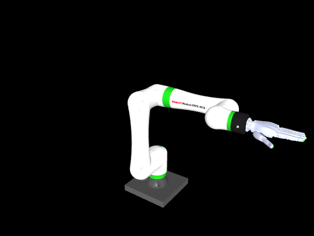

# 單側 FANUC CRX-5iA＋Sharpa Wave 匯入與可視化

調查與本地匯入日期：2026-10-14。這份資產選用 `bimanual_manipulation` 預設的**左側**：一支 FANUC CRX-5iA 手臂和一隻 Sharpa Wave 左手。目前只用來載入、檢查模型與顯示；尚未加入 Ada Grasp Ctrl 的 `RobotFactory`、Hydra 手型設定或控制流程。

## 已建立的檔案

- [model.urdf](assets/robot/crx5ia_sharpa_wave_left/model.urdf)：獨立的單側模型，mesh 路徑相對於模型檔，可直接交給 MuJoCo。
- `assets/robot/crx5ia_sharpa_wave_left/meshes/`：25 個 Sharpa STL、7 個 FANUC 碰撞 STL、17 個保留材質分區的 FANUC 外觀 STL；另保留先前合成的 7 個單色外觀 STL，但模型不再引用。全部 56 個網格的 SHA-256 見 [SHA256SUMS.txt](assets/robot/crx5ia_sharpa_wave_left/SHA256SUMS.txt)。
- [SOURCE.md](assets/robot/crx5ia_sharpa_wave_left/SOURCE.md)：來源 checkout、版本、轉換方式、授權紀錄與限制。
- [預覽圖](assets/robot/crx5ia_sharpa_wave_left/preview.png)：已由這份 URDF 在 MuJoCo 離屏渲染產生。
- [靜態預覽腳本](script/preview_crx_sharpa_asset.py)：開啟 MuJoCo 視窗、不推進物理模擬，並只顯示外觀網格。



## 來源與接合方式

`bimanual_manipulation` 並沒有一份可直接複製的固定「一臂一手」模型。它的 `composite_description.py::build_description(sides="left")` 先展開 `dual_crx_control/urdf/dual_crx.urdf.xacro`，移除右臂，再接上 `dual_sharpa_wave_ros2/urdf/left_sharpa_wave_with_flange.urdf`。CRX 幾何和關節來自 ROS workspace 的 `fanuc_crx_description`。

FANUC 原始套件位於本機 `/home/howard/ws_fanuc/src/fanuc_description/`，其 Git origin 為 [FANUC-CORPORATION/fanuc_description](https://github.com/FANUC-CORPORATION/fanuc_description)，checkout commit 為 `fb40c9803a826ba68c7c8e28ba904a25efa7fcd2`。這次使用既有的本機檔案，沒有重新下載。

| 項目 | 來源定義 | 本次結果 |
| --- | --- | --- |
| 手臂關節 | `left_J1` 到 `left_J6` | 6 軸 |
| 手部關節 | Sharpa 左手 URDF | 22 軸 |
| 固定接合 | `left_ee_mount → left_hand_flange` | `left_arm_to_hand` |
| 展示用接合位姿 | `bimanual_manipulation/config/hand_mounts.yaml` | `xyz=[0,0,0]`、`rpy=[0,1.570796,0]` |
| 另外保留的 TCP | `left_ee_mount → left_tcp` | 沿 X 軸 `0.035 m`；不是手部接合點 |

來源檔案明確註記手部接合位姿是 **mock preview placeholder**，不能把這個顯示結果當作實機法蘭校正。

## 如何從來源匯入

這次使用來源專案的組裝函式產生單側 URDF，而不是手工合併關節樹。在已有 ROS Jazzy 與 `ws_fanuc` build 的 WSL shell 中，原始組裝步驟是：

```bash
source /opt/ros/jazzy/setup.bash
source /home/howard/ws_fanuc/install/setup.bash
/usr/bin/python3 - <<'PY'
from pathlib import Path
from bimanual_manipulation.composite_description import build_description
Path('/tmp/crx5ia_sharpa_left_source.urdf').write_text(build_description(sides='left'))
PY
```

組裝後的 URDF 有 ROS `package://` 路徑，MuJoCo 不能直接用那些 URI 定位本地 mesh。本次把它們改為 `model.urdf` 旁的 `meshes/` 相對路徑。FANUC 原始 DAE 外觀網格以 `trimesh` 按材質分區轉為 17 個 STL，沿用 DAE 在 URDF 中的外觀位姿與公尺單位，並把各區塊的漫反射顏色寫入 URDF；碰撞網格仍使用原始 STL、原本的碰撞位姿與 `0.001` 縮放。Sharpa 的 STL 視覺與碰撞網格維持來源內容。最後加入 MuJoCo URDF `<compiler strippath="false" balanceinertia="true" discardvisual="false"/>`，保留相對路徑並編譯視覺幾何。先前曾錯把 FANUC 碰撞 STL 放在 DAE 的外觀位姿上，造成手臂外形錯位；現在已修正。轉換細節與來源 commit 見 [SOURCE.md](assets/robot/crx5ia_sharpa_wave_left/SOURCE.md)。

## 直接可視化

在本 repo 根目錄、已啟用 `ada-grasp-ctrl` Conda 環境時，開啟 MuJoCo 互動視窗：

```bash
python script/preview_crx_sharpa_asset.py
```

這個腳本只更新視窗，不呼叫 MuJoCo 的 `mj_step`，並把碰撞幾何所在的顯示群組 0 關閉，保留外觀幾何所在的群組 1。MuJoCo 預設同時顯示兩組，FANUC 簡化碰撞外殼會遮住原始外觀網格，使每節手臂的形狀看起來都不對；手部碰撞與外觀比較相似，所以較不明顯。這項設定只影響顯示，模型內的碰撞幾何仍在。模型沒有 actuator；若使用 `python -m mujoco.viewer --mjcf=...` 讓模擬持續運行，手臂也會受重力影響而塌下來。若只想看圖片，直接開啟上面的 [PNG 預覽圖](assets/robot/crx5ia_sharpa_wave_left/preview.png)。

目前 MuJoCo 預覽已保留 FANUC 的白、灰、綠、紅色區塊。若要看原始 DAE 的完整材質表現，也可以用 ROS mock 與 RViz（不連實體）：

```bash
source /opt/ros/jazzy/setup.bash
source /home/howard/ws_fanuc/install/setup.bash
ros2 launch bimanual_manipulation single_arm_hand.launch.py \
  prefix:=left_ crx_mock:=true sharpa_backend:=mock rviz:=true
```

## 已驗證與後續界線

用專案 Conda 環境的 `mujoco.MjModel.from_xml_path(...)` 載入本地 `model.urdf` 成功：**29 個 MuJoCo body、28 個可動 joint、83 個 geom、49 個 mesh**。離屏渲染也成功。預覽採用所有關節的零位，以及來源設定中的展示用手部接合位姿；它仍可能不同於你預期的實機姿態。這只證明模型可載入與顯示；目前沒有驗證物理動力學、接觸品質、手部驅動、真機法蘭校正、抓取資料格式或控制器相容性。下一階段若要用在控制流程，需另外設計精確的 28 軸關節順序、actuator 映射、接觸 body、感測器與輸入資料；這些尚未加入公開支援矩陣。

Sharpa 和 FANUC 的授權／來源紀錄已放在資產目錄。`dual_crx_control/package.xml` 的 license 欄位仍是 `TODO: License declaration`，因此此展示資產未宣稱可對外再散布。
