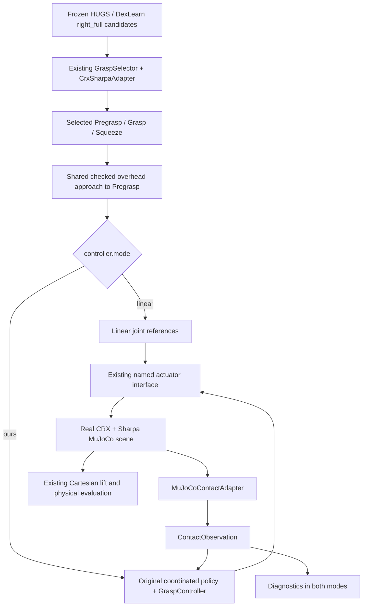

# Real CRX + Sharpa right_full: Linear / original Ours

Integrated into `/home/hao-fang/hugs-workspace/ada-grasp-ctrl`, on `main` at
`3c70c3211c9dbe181fd9558c64bbbe6016502b14` as the integration base.
The implementation was originally developed from `57d357b` in an isolated linked
worktree. Since then, the concurrent dual-arm work was committed as `3c70c32`;
its 29 changed files were inventoried and preserved. There was no overlapping
source conflict. No controller mathematics, robot assets or physical settings
were changed during this integration.

## Architecture audit

| Concern | Existing implementation and disposition |
|---|---|
| Actual right-arm MuJoCo entrypoint | `script/test_crx_sharpa_right_controller.py` / `.sh` → `experiments/crx_sharpa_right_evaluation.py`. Uses frozen preview scenes, `RightEvaluator`, `ApprovedScene`, and **real six-revolute-joint CRX + 22-joint Sharpa**. Reused. |
| Other similarly named example | `script/run_crx_sharpa_phase2.py` → `crx_sharpa_adaptive.py` composes `hand=crx_sharpa_left`; it is not the right_full entrypoint used here. |
| Original research evaluation | `tasks/control_eval_func/base.py`, `episode_runner.py`, `optimized_runner.py`, `tabletop_dummy_arm_ours.py`; public dummy-arm evaluation remains intact. |
| HUGS/DexLearn data | `experiments/hugs_sharpa_input.py`, `sharpa_regression.py`, and `crx_sharpa_right_preparation.py` already freeze predictions, metadata, stages, registration, and model dependencies. `load_preview()` verifies the report, suite and dependency hashes. No inference or checkpoint modification. |
| Existing measured candidates | `grasp_selection/adapters/dexlearn.py` validates saved world-frame flange poses and 22 named hand joints. It does not supply a complete object collision solid. The new executable consumes the existing **frozen simulation preview**, not an incomplete camera point cloud. |
| Actual grasp selector | `GraspSelector(CrxSharpaAdapter)` performs existing bounded real-CRX IK, endpoint checks, `JointDisplacement` scoring and deterministic tie-breaking. The new bridge packages frozen flange targets as `StageTarget`; it invokes this selector, then executes its selected `stage_checks[*].q_rad`. No ranking/filter changes. |
| Stage representation | `pregrasp_qpos`, `grasp_qpos`, `squeeze_qpos`: 28 angles in canonical `right_J1`…`right_J6`, then named Sharpa order. Original registered flange poses and hand angles are retained. |
| Joint references | Native `GraspController.interplote_qpos()` is already `np.linspace(..., steps+1)[1:]`. Shared runner initializes from measured joints, approaches grasp for 2 s, then interpolates grasp→squeeze for 2 s. Reused and independently checked against the linear formula. |
| Actuator application | `MjHO.ctrl_qpos_a_with_interp()` linearly interpolates targets. `ApprovedScene` validates named transmissions and steps MuJoCo with existing contact diagnostics. Reused. |
| Original contacts | `MjHO.get_curr_contact_info()` canonicalizes geom ordering into hand-first/object-second dictionaries; `GraspController.Ks()` consumes local point/frame/body and force. New adapter reuses the same canonicalization function. |
| ROS bridge | `pipeline/runner.py`, `pipeline/plan.py`, `ros_execution/` handle reviewed ROS execution and quintic playback. Not imported by this entrypoint. |
| Newer dual-arm environment | `robot_environment/model.py` / `simulation.py` have a 56-axis exported scene and 0.002 s timestep. They are separate from the existing single-right CRX scene and were not modified or substituted. |



## Implementation and mathematical compatibility

New execution code is in `experiments/right_full_control.py`,
`right_full_episode.py`, and `right_full_pipeline.py`. `Controller.reset(runner)`,
`step(state, observation, dt, timestamp=...)`, and `diagnostics()` wrap the native
`_CoordinatedWrenchPolicy`; they do not contain an optimizer. The only existing
source modification adds optional `evaluator_factory` and `config` arguments to
`crx_sharpa_right_evaluation.run_episode()`. Its defaults preserve old callers.

`ours` calls the original wrench balance solver and `ctrl_opt()` with the original
stage switching, desired-force progression, friction constraints, stiffness,
position/velocity constraints, weights, tolerances and failure policy. Stage 1
tracks hand-base Z/orientation (the original X/Y weights remain zero); Stage 2
freezes the arm and uses the existing hand-only stiffness option. These are
properties of the original formulation, not changes to make CRX work.

The compatibility boundary is explicit:

- `RightCrxSharpa`/`RightCrxArm` already describe the real arm. The 28×28 actuation
  map must be identity, the six arm coordinates must precede the 22 hand
  coordinates, and names must match. In particular, the original `Ks()` uses
  actuator-coordinate Jacobian calls for measured joint coordinates; this is valid
  for this independent identity map. Underactuated or coupled models are rejected.
- `RobotAdaptor` maps the same URDF joint set into Pinocchio ordering. `ArmHand`
  exposes the actual arm limits, gains and velocities; the controller tracks the
  Sharpa palm frame. Runtime checks compare stiffness gains and actuator bounds
  with the actual MuJoCo model.
- Measured joint state (`q_f`) and previous actuator target (`q_a`) remain distinct,
  as required by the original stiffness model. `get_qpos_a()` returns targets,
  not measured positions. No Cartesian-to-dummy-arm approximation is introduced.
- `RightKinematics.audit()` checks every retained body and world Jacobian at all
  three selected endpoints. Maximum observed position difference was
  **3.623e-7 m**, rotation **6.379e-8 rad**, Jacobian entry **6.199e-8**. These are
  within the existing 1e-6 tolerance for exported MJCF rounding. A separate test
  checks local contact-point Jacobians against MuJoCo `mj_jac()` on real contacts.

Commands are checked for dimension, finiteness, joint limits and per-update speed
before actuator writes. Original `apply_candidate`/`hold_current`/`fail_episode`
handling remains in the original solver; even `apply_candidate` cannot bypass
this execution boundary with unsafe position/speed values. Errors retain partial
records and the original exception. There is no fallback to linear.

## Contact contract

`contact/types.py` and `validation.py` require only NumPy/Python, not ROS or
MuJoCo. A future source implements `ContactSource.observe()` and can be injected
through `RightFullEvaluator(..., contact_source=source)`.

`ContactObservation` contains timestamp, source, validity, errors and an ordered
list of individual contacts. Each retains:

- `body1_name` (hand), `body2_name` (object), `hand_side`, geom/contact identity;
- `contact_pos` in world meters, `contact_pos_local` shaped (3,1) in hand-body meters;
- `contact_frame`, `contact_frame_local`: right-handed orthonormal **column axes**;
- `contact_force`: six components `[Fn, Ft1, Ft2, Tn, Tt1, Tt2]` in N / N·m;
- `normal_force`, timestamp, source and validity.

Canonical +X points hand→object and the wrench acts **on the object**. MuJoCo's
row-axis frame and force on geom2 are transformed by the existing
`canonicalize_contact_frame_wrench()`. Reversing geom order preserves world force
and torque. Contacts are never aggregated, even on the same finger/body.
Object-table/other object contacts are recorded separately in
`environment_contacts` with explicitly raw geom2 wrench semantics; they never
enter the hand-contact optimizer or force totals.

Sampling does not advance physics or run FK. The latest snapshot is acquired at
every control tick and checked against the same simulated acquisition timestamp.
It reads the current MuJoCo constraint buffers, exactly like the native extractor;
there is no previous-control-interval cache. After `mj_step`, those buffers can
represent the last physics evaluation before integration (up to one 0.004 s
substep earlier than integrated qpos). No extra `mj_forward` is inserted at grasp
ticks, preserving native numerical parity; `timestamp` denotes acquisition time,
not a claim of an additional force solve at that instant. A valid empty
snapshot means contact loss. Invalid/stale/nonfinite frames, forces or missing
required quantities reject the snapshot; no fabricated zero measurements replace
them. Native MPC receives disposable dictionary copies because its stiffness
routine adds derived Jacobians. The observation log retains the source snapshot.

Real tactile integration still needs measured/estimated positions, calibrated
wrenches, body/world transforms and clock alignment. Unavailable quantities must
be marked invalid and rejected; this task provides no tactile calibration,
estimator, ROS topic or SDK connection.

## Timing, motion and outcome

`controller.ours.frequency_hz` must equal **10**. The existing single-right scene
uses **0.004 s** physics steps, unchanged. Runtime derives and validates
`0.1 / model.opt.timestep`: here **25 substeps**, retaining five outer linear
actuator increments, each held for five physics steps. A non-integral period or
one incompatible with the existing five-step inner hold fails explicitly.

Both modes reuse the existing checked raise/translate/orient/descend overhead
route and measured palm arrival checks (1 mm / 0.01 rad, up to 3 s settling).
Its existing Cartesian IK/Slerp path generation is unchanged; all new joint
references and actuator interpolation are linear. Object drift before grasp is
rejected using those existing pose tolerances, without moving frozen targets.

After pregrasp, both modes use the same 2 s approach and 2 s squeeze references.
`linear` executes all 40 references without balance checks or contact corrections.
`ours` preserves the original force-stop condition and 80-update maximum. Timeout,
reference completion and measured terminal joint error are recorded separately;
contact can prevent fingers reaching commanded endpoints.

MPC ends before lift. The original lift remains 20 continuously seeded Cartesian
IK waypoints over 2 s, +0.2 m world Z, with the existing 0.35-rad branch check and
hand command held. No new hold phase is added. Physical success remains exactly
`abs(object_z_at_control_start + 0.2 - terminal_object_z) < 0.1` after completed
lift. `grasp_success` uses this existing physical lift test; unexecuted lift is
null. Reference completion alone never establishes success.

Gravity emulation (1 N down on the object), collision exclusions, gains, object
poses, friction, source geometry and solver settings are inherited unchanged
from `ApprovedScene` and the frozen suite. Forbidden collision history remains
recorded; a violation during new grasp execution stops it before lift.

## Configuration and runnable commands

The entrypoint uses existing OmegaConf/Hydra configuration. Scientific parameters
come from the frozen suite's existing `phase_config()`; the small additional file
is `src/ada_grasp_ctrl/config/right_full.yaml`:

```yaml
controller:
  mode: ours  # linear | ours
  ours:
    frequency_hz: 10
trajectory:
  interpolation: linear
contact:
  source: mujoco
```

The unified entrypoint is `ada_grasp_ctrl.experiments.right_full_pipeline`.
It now has an explicit `__main__` dispatch; previously importing its `main()` via
the script worked, but direct `python -m` silently did nothing. The shell wrapper
calls the same module, and the older Python script remains a thin compatibility
wrapper. No second execution pipeline was introduced.

These commands were verified from the original repository using its existing
Python 3.10 environment, without sourcing ROS or activating a shell environment:

```bash
cd /home/hao-fang/hugs-workspace/ada-grasp-ctrl
unset PYTHONHOME
export PYTHONPATH=/home/hao-fang/hugs-workspace/ada-grasp-ctrl/src
export OPENBLAS_NUM_THREADS=1 OMP_NUM_THREADS=1

/home/hao-fang/hugs-workspace/ada-grasp-ctrl/.conda/bin/python -m ada_grasp_ctrl.experiments.right_full_pipeline \
  --controller linear --sample-id g0000 \
  --preview-root output/regression/crx-sharpa-right-preview-x080-y070-config-v1 \
  --output-root output/right_full_integration/linear

/home/hao-fang/hugs-workspace/ada-grasp-ctrl/.conda/bin/python -m ada_grasp_ctrl.experiments.right_full_pipeline \
  --controller ours --sample-id g0000 \
  --preview-root output/regression/crx-sharpa-right-preview-x080-y070-config-v1 \
  --output-root output/right_full_integration/ours

/home/hao-fang/hugs-workspace/ada-grasp-ctrl/.conda/bin/python -m ada_grasp_ctrl.experiments.right_full_pipeline \
  --compare --sample-id g0000 \
  --preview-root output/regression/crx-sharpa-right-preview-x080-y070-config-v1 \
  --output-root output/right_full_integration/compare
```

Use **new output directories** when repeating these commands. `--config` accepts
an alternative file with the same fields. Unknown controller names (including
`mpc`/`op`/`compare`) fail preflight; comparison is an execution option (`--compare`),
not a third controller policy. Repeating `--sample-id` is supported only for
candidates sharing the same frozen scene. Both comparison modes execute the same
single selection. The g0000 test goes through the actual CRX selector.

`--help`, invalid controller and missing required arguments have subprocess tests
against the Python module itself. The documented explicit `PYTHONPATH` excludes
inherited ROS Python packages. Alternatively, `bash script/run_right_full.sh`
performs this path isolation and calls the same module using `PYTHON_BIN` or
`.conda/bin/python`. No ROS process, hardware driver or running robot is required.

Outputs include `selection.json`, selected grasp, preflight route,
`run_manifest.yaml`, mode-specific resolved configuration, native `control.npy`,
scene/replay files, collisions, `diagnostics.json`, result files, run report and
`failures.jsonl`. Existing roots are never overwritten. Exit 0 means execution
completed (physical failure remains possible); 1 indicates execution/solver
failure; 2 indicates preflight failure.

Each diagnostic contains mode, control index, simulated time, reference, command,
measured joints, contacts/forces, object pose/displacement, tracking error, stage,
solver duration, balance metric and original solver outcomes. `timestamp` is the
pre-action contact time; `state_timestamp` identifies the post-action measured
state. Force maxima are **10 Hz sampled maxima**, not guaranteed physics-rate
peaks. MPC-only fields are null/absent for linear and non-MPC approach/lift steps.

## Original implementation validation (before integration)

The original development evidence was generated under `output/right_full_validation/`:
`comparison/`, `direct_native/`, `repeat/`, `validation.json`, and
`historical_comparison.json`. These are generated artifacts, not committed data. They are archived outside the
repository during worktree cleanup; current integration results are generated
fresh under `output/right_full_integration/`.

| g0000 metric | linear | ours |
|---|---:|---:|
| Physical grasp/lift | success | success |
| Grasp control updates | 40 | 40 |
| Updates with hand/object contact | 34 | 31 |
| Object lift delta | 0.18072042 m | 0.17976387 m |
| Maximum sampled contact-force norm | 11.20804 N | 7.59871 N |
| Maximum sampled sum normal force | 23.35169 N | 15.24922 N |
| Maximum contact count | 4 | 4 |
| Terminal maximum joint/reference error | 0.16348 rad | 0.13156 rad |
| MPC stages | not applicable | 1 and 2 |
| Command solver mean duration, this CPU run | not applicable | 6.54 ms |
| Solver outcome | not applicable | success; no degradation |

Repeated runs had **194 bitwise-identical recorded frames per mode**, including
initialization, control, lift and terminal state. The two modes have identical
control-start qpos/qvel/ctrl/act/object pose and use identical seed and targets.

Original direct-contact `RightEvaluator` versus the new adapter on the **same
selected target** had **maximum absolute difference 0** for measured/commanded
joint trajectories, object poses, references, stages, balance/force progression
and optimized commands. Tests retain the repository's `rtol=1e-5, atol=1e-6`.
The existing selector re-solves IK; its largest difference from frozen joint
vectors was 4.175e-14 rad. Earlier frozen-target baseline lift values were
0.180868 m (op) and 0.179789 m (ours). Those tiny IK differences can propagate in
contact dynamics; they are not an adapter/direct-controller discrepancy.

Checks performed:

- Baseline before implementation: 287 tests, initially 41 failing assertions and
  one error from absent submodule meshes in the fresh worktree. Reusing unchanged
  local dependency files resolved these: 287 tests passed, 20 skipped.
- New tests: 19 passed, including ROS import blocking, linearity/endpoints/order,
  no optimizer in linear, timestep rejection, geom-order force/frame equivalence,
  direct extraction parity, multiple contacts on one body, contact loss, invalid
  measurement rejection, real CRX Jacobians, native MPC parity, repeatability,
  command rejection without stepping, solver abort, timeout and pregrasp drift.
- Full suite: 306 tests, 20 skipped, no failures (see final test log). Skips concern
  the separate dual-arm snapshot (10), ROS receiver (7), system OpenCV projection
  (1), local camera captures (1), and an existing default-path CRX fixture (1).
  The new explicit-preview real-CRX integration tests ran and passed.
- Existing Sharpa smoke: 8 completed episodes, no solver degradation; both
  historical phases had 3 successes and 1 physical failure. This suite retains
  its historical dummy-arm robot and is reported separately from real-CRX tests.
- Compileall, whole-tree Ruff lint, shell syntax, changed-file Ruff formatting,
  and `git diff --check` passed. Whole-tree formatting still reports 8 pre-existing
  files; the same failures were reproduced in pristine `57d357b`.

The maintained quick **release gate does not pass** against its checked-in golden
inventory. It stops at Shadow; Allegro and LEAP were then run separately. All
300 current numeric trajectories, optimized commands, stages, contact counts and
classifications match a freshly executed **pristine 57d357b** baseline exactly
(maximum difference 0). The unchanged golden inventory differs on 3 Shadow,
1 Allegro and 1 LEAP sample; exact IDs and transitions are retained in
`historical_comparison.json`. No golden values or tolerances were changed.

| Historical quick set | Success | Failure | Invalid | Degraded | Execution error |
|---|---:|---:|---:|---:|---:|
| Shadow, pristine = implementation | 68 | 4 | 21 | 7 | 0 |
| Allegro, pristine = implementation | 79 | 6 | 14 | 1 | 0 |
| LEAP, pristine = implementation | 87 | 6 | 7 | 0 | 0 |

An initial pristine/Allegro rerun accidentally inherited `/opt/ros` Python paths
and loaded Python-3.12 Pinocchio under Python 3.10. Those invalid runs were
rejected and rerun in fresh directories with `PYTHONPATH=src`; the shell entrypoint
now applies the same isolation automatically. This was environment contamination,
not a ROS dependency of offline execution.

## Limits and next integration point

This proves complete, contact-aware simulation and lift of the same frozen g0000
right_full grasp under both modes. It does not establish success across all
scales/candidates, arbitrary camera scenes or physical robots. Frozen preview and
model dependencies must exist; arbitrary measured point clouds are not silently
converted into collision geometry. Historical invalid/unreachable candidates
are not moved, repaired or resampled. Full 2,000-episode evaluation was not run.

The independent observation contract is ready for a calibrated tactile source;
real tactile world reconstruction and asynchronous measurement policy remain
future work. The original MPC has been preserved, including its stage allocation
and research approximations. It has not been extended into lift or into the
concurrent dual-arm simulation.

## Integration and cleanup validation

Integration retained HEAD `3c70c3211c9dbe181fd9558c64bbbe6016502b14` on `main`.
The original checkout was clean when this task began; the previously concurrent
dual-arm changes were already committed. Every one of its 29 newer files, and
all **3,241 non-integration tracked files**, retained its pre-transfer SHA-256.
There were no source conflicts or staged changes. Nothing was committed or pushed.

Merge inventory (all paths relative to the original repository):

| Action | Files |
|---|---|
| New controller/backend/entrypoint | `src/ada_grasp_ctrl/experiments/right_full_control.py`, `right_full_episode.py`, `right_full_pipeline.py` |
| New contact contract | `src/ada_grasp_ctrl/contact/__init__.py`, `types.py`, `validation.py`, `mujoco_adapter.py` |
| New config | `src/ada_grasp_ctrl/config/right_full.yaml` |
| Convenience wrappers | `script/run_right_full.py`, `script/run_right_full.sh` |
| Tests/documentation | `tests/test_right_full_control.py`, this document |
| Minimal existing-file edit | `src/ada_grasp_ctrl/experiments/crx_sharpa_right_evaluation.py`: optional evaluator/config injection only; unchanged since the development base, so no conflict |
| Explicitly excluded | Old generated outputs/logs/caches, dependency copies, environments, unrelated dual-arm files, robot assets, checkpoints, ROS bridge, selector/controller mathematics |

The only code changes made while finalizing this transfer were the Python module's
`__main__` dispatch, shell delegation to that module, and its subprocess CLI test.
No MPC or contact/simulation redesign was performed.

Validation was repeated before transfer and independently from the original
checkout. Direct `python -m` invocations for linear, ours and compare reproduced
all listed g0000 lift/force/update metrics. Their individual and compare replay
states were bitwise identical. Native direct-contact versus adapted MPC had
maximum difference **0** for commands, states, stages and canonical contact fields.
Both actual CRX (six joints) and Sharpa (22 joints) mappings were exercised at
10 Hz with the unchanged 0.004 s physics timestep.

- Original checkout baseline: **351 tests run, 298 passed, 53 skipped**.
- After integration: **371 tests run, 318 passed, 53 skipped, zero failures**.
  All 20 right_full tests ran, including native parity, contact robustness,
  repeated simulation, ROS import blocking and module CLI checks.
- The larger counts reflect the newer committed dual-arm tests. The prior
  development figure was **306 tests run**, not 306 passing plus 20 skipped.
- Existing Sharpa smoke: 8 completed episodes, matching the retained baseline;
  both historical phases retained 3 successes / 1 physical failure.
- The maintained quick gate still stops on the historical Shadow golden mismatch.
  All 100 integrated Shadow classifications, trajectories and optimized commands
  exactly matched freshly recorded pristine-57d357b evidence (maximum difference
  0). The previously documented golden mismatches are not new integration failures.
- Whole-tree lint, changed-file formatting, compileall, shell syntax and
  `git diff --check` passed. No baseline or physical threshold was modified.

A complete additional comparison ran with ROS/hardware imports and network
connections rejected by an audit harness. Rendering was disabled for that audit;
only PyTorch's read-only `lscpu` capability probe was permitted alongside Git.
All imported Ada modules resolved inside the original repository; none resolved
to the development worktree. Source, config, scripts, tests and documentation
were searched for stale development paths. Current execution uses only the
original repository, its Python environment and the existing frozen data assets.
Earlier overly strict audit attempts rejected GLFW/PyTorch capability probes;
they were retained as diagnostic logs and rerun in fresh output directories.

Cleanup completed using **`git worktree remove` without `--force`**. Before removal,
all 13 implementation files were verified against the original checkout and
archived. Historical development outputs and populated dependency copies were
moved outside the repository. Only the known transferred modification was
restored in the temporary checkout; verified duplicate new files were removed
there. Git initially reported deleted submodule directories after their copies
were archived. Restoring empty uninitialized gitlink placeholders yielded a clean
worktree, and normal Git removal then succeeded. Original submodule metadata,
revisions and files were preserved. No destructive reset or `rm -rf` was used.

Retained evidence is in
`/home/hao-fang/hugs-workspace/right-full-mpc-integration-evidence/`:
`inventory.json`, file hashes, test logs, native/isolation/baseline parity reports,
`cleanup.json`, and `development-archive/`. Historical archived manifests retain
their original absolute paths as provenance; they are not runtime dependencies.
Fresh original-repository runs are under `output/right_full_integration/`.
The separate pre-existing `/tmp/ada_mpc_pristine` historical-baseline worktree was
left intact. The requested development worktree no longer exists. Integration validation left
the changes uncommitted in the original repository for review; they were subsequently
submitted for a user-requested local commit.
